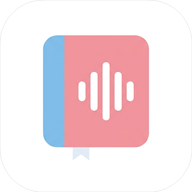

<p align="center">
  
</p>

<h1 align="center">电波日记 (Radio Diary)</h1>

<p align="center">
  <b>面向跨性别女性（MtF）与人声探索者的纯本地嗓音练习手账 · v2.0.0</b><br>
  <i>零联网上传 · 去病理化表达 · 声学反馈 + 练习记录 + 外部 AI 导出联动</i>
</p>

---

## ✨ 项目简介

**电波日记** 是一款在设备端完全离线运行的嗓音练习记录与声学辅助工具，前身为「清籁手帐（1.x）」。它希望把枯燥甚至容易让人焦虑的“参数打分”，变成一本安静、可信、温和的日常练习手账：

- **去病理化与温柔引导**：不给声音贴病理标签或单一优劣评分；将喉部松弛度、音重与共鸣空间呈现为可觉察、可微调的客观状态。
- **纯本地运算与极致隐私**：所有录音采集、DSP 声学分析（Web Worker 异步运行）、手账记录（IndexedDB / LocalStorage）与文件导出均在本地设备完成，**零云端 API、零埋点、音频不出设备**。
- **与外部 AI 的开放衔接**：不内置云端大模型，而是支持一键导出结构化 Markdown / JSON 练习报告与声学特征摘要，方便你按需交由自己信任的外部 AI 进行复盘与训练计划调整。

> 📚 **关于理论知识库**  
> 本应用涉及的普通话跨性别嗓音训练体系、解剖生理学与声学常模已作为一个独立开源项目维护和发布：  
> 👉 **[xling001/transvoice-mandarin-handbook（跨性别女性嗓音训练解剖与声学常模知识库 · 普通话版）](https://github.com/xling001/transvoice-mandarin-handbook)**  
> 为避免重复维护，知识库全文不冗余存放于本代码仓库中；软件内的「指南」页面亦已直接提供该知识库的跳转入口。

---

## 🎯 核心功能

### 1. 三种练习模式 + 自由照镜
- **自由说**：自然聊天或朗读任意文本，观察实时音高曲线、专属安全托底线（可在 150–165 Hz 间调节）与轻重/明暗实时感知。
- **读素材**：搭配内置分场景练习句库与自定义素材逐句跟练。
- **做测试**：针对持续元音（如 /i/、/u/）与清擦音 /s/ 的基准测量，观察前腔共鸣间距 $\Delta F$ 与发音状态。
- **自由照镜模式**：关闭「记入手帐」开关即可随时只看曲线与即时反馈，不占手账空间。
- **本地音频导入**：支持导入手机或电脑上的常见录音文件，复用同一套离线声学分析流水线生成报告。

### 2. 多维度离线声学引擎 (`ALGO_VERSION 0.5.0` / `KB_VERSION 1.3.0`)
通过 `app/web/src/core/index.js` 门面统一暴露给视图层，在 Web Worker (`analysis-worker.js`) 中异步执行：
- **音高与安全托底**：YIN 算法基频追踪、基频微扰剔除、语调跨度（$P_{10}$–$P_{90}$ 半音跨度 `ST`）与跌破安全托底线比例。
- **音重与声门闭合 (Vocal Weight)**：$H_1-H_2$ 修正开商差值、斜率指标与基频减半（Halving）检出，辅助区分过紧压喉与柔和轻盈振动。
- **前腔共鸣与明亮度 (Resonance)**：LPC 线性预测共振峰与 $\Delta F$ 计算、清擦音 `/s/` 频谱重心分析，并包含对挤压代偿的防御联动提示。
- **气流与稳定度**：Jitter、Shimmer、HNR 谐噪比与 CPP 倒谱峰突出度。

### 3. 水彩手账、历史趋势与外部 AI 导出
- 每次练习可盖下一枚心情与体感印鉴，在「手账」与「分析」页回看长线变化。
- 支持整本手账的本地备份还原（JSON）与面向外部 AI 顾问的结构化报告导出（Markdown）。

---

## 📁 目录结构

```text
radio-diary/
├── app/
│   ├── android/                 # 免 Gradle 原生 Android WebView 宿主外壳（包名 com.transvoice.voice）
│   │   ├── AndroidManifest.xml
│   │   ├── java/com/transvoice/voice/MainActivity.java
│   │   └── res/                 # 应用图标与字符串资源
│   ├── web/                     # Svelte 5 + Vite 前端与离线声学引擎
│   │   ├── index.html
│   │   ├── package.json
│   │   ├── vite.config.js
│   │   ├── serve.mjs            # 零依赖本地预览静态服务器
│   │   └── src/
│   │       ├── audio/           # 音频帧抽取与门控前处理 (capture.js)
│   │       ├── core/            # 算法只读门面、分类与报告导出 (index.js, catalog.js, export.js)
│   │       ├── dsp/             # 纯算法模块 (pitch, formants, spectralVoice, sibilance, tone, voiceQuality, cpp, fft)
│   │       ├── metrics/         # 声学常模 (kbNorms.js)、门控汇总与分段统计
│   │       ├── pages/           # 练习、分析、手账、素材库、指南、设置页面
│   │       ├── state/ & store/  # Svelte 5 状态与本地持久化存储
│   │       ├── style/           # 设计 Token 与水彩手账主题样式
│   │       └── ui/              # 基础 UI 组件与弹窗
│   └── scripts/                 # 自动化校验、合成音单测与 Android APK 构建脚本
├── CHANGELOG.md
├── LICENSE
└── LICENSE-THIRD-PARTY.md
```

---

## 🚀 本地开发、校验与打包

### 环境要求
- **Node.js**（建议 v20+，含 `npm`）
- **仅 Android 打包需要**：JDK 17+ / 21、Android SDK `platforms;android-34` 与 `build-tools;34.0.0`（可通过 `app/scripts/setup-android.ps1` 自动配置）

### 1. 安装前端依赖与本地调试
```bash
cd app/web
npm ci
npm run dev       # 启动 Vite 本地开发服务器
npm run build     # 生成纯静态产物至 app/web/dist/
```

### 2. 运行全套静态检查与声学单测（无需真实录音或设备）
```powershell
# PowerShell 静态语法、DOM 引用与转义检查
.\app\scripts\check.ps1

# 架构红线、去病理化措辞、Token 门禁与门面一致性校验
node .\app\scripts\verify-contract.mjs

# Svelte 组件 Design Token 审计
node .\app\scripts\audit-svelte-tokens.mjs

# 声学算法合成信号回归测试
node .\app\scripts\test-pitch.mjs
node .\app\scripts\test-formants-vowel.mjs
node .\app\scripts\test-sibilance.mjs
node .\app\scripts\test-vq.mjs
node .\app\scripts\test-metrics.mjs
node .\app\scripts\test-dsp-full.mjs
node .\app\scripts\test-audit-round.mjs
```

### 3. 构建 Android Debug APK（免 Gradle 极速出包）
```powershell
# 自动触发 Vite build，并通过 aapt2 + javac + d8 + zipalign + apksigner 打包
.\app\scripts\build-apk.ps1
# 输出位于：app\build\transvoice-2.0.0-debug.apk
```

---

## 📖 致谢与参考

感谢在跨性别嗓音训练科普、开源工具与语音声学规范上铺路的先驱与研究者：
- **Aoi 的跨性别嗓音训练指南** — 通俗易懂的训练框架与包容视角
- **TransVoice-Wiki 中文翻译项目** & **SumianVoice / Voice Resource Project** — 现代双支柱声学感知框架
- **[Koenami](https://github.com/transnavi/koenami)** — 指标定义、基频减半检出与归一化参考
- **[simple-voice-tools-for-trans](https://github.com/theforeveriris/simple-voice-tools-for-trans)** — 纯前端 YIN 与共振峰实现参考
- **Praat** (Paul Boersma & David Weenink) — 语音声学对照基准
- **《嗓音解剖》(Anatomy of the Voice)** (Theodore Dimon) — 喉部软骨与肌群解剖学参考

### 研发与致谢
- **设计与研发**：**溪泠 ([@xling001](https://github.com/xling001))**，协同 Google Antigravity 完成全栈架构、DSP 算法工程化与手账交互打磨。
- **声学顾问与评审**：感谢 **DSH 老师** 在算法演进过程中提供的严谨声学审计与临床常模建议。

---

## 📄 开源许可证

本项目基于 [MIT License](LICENSE) 开源。
