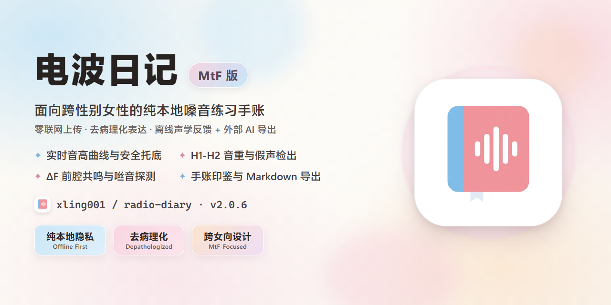
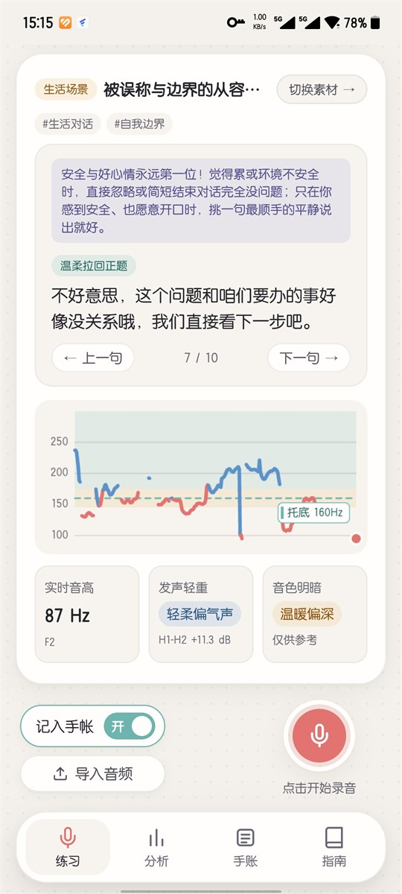
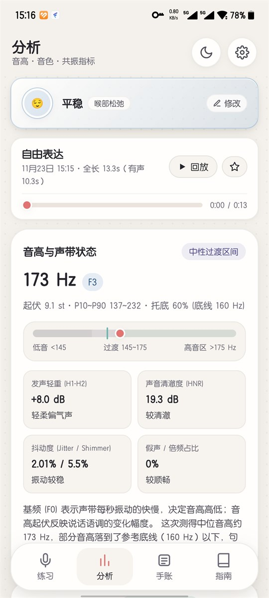
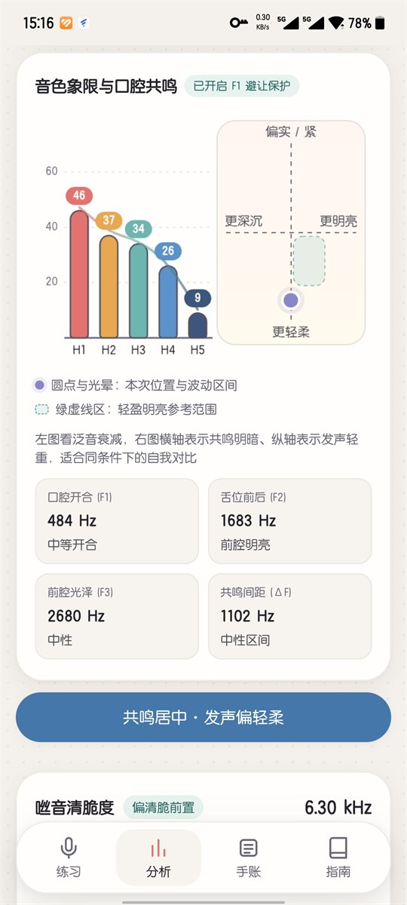
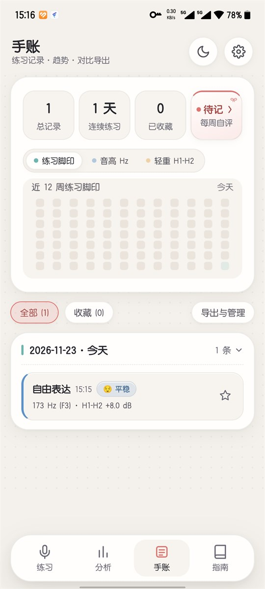
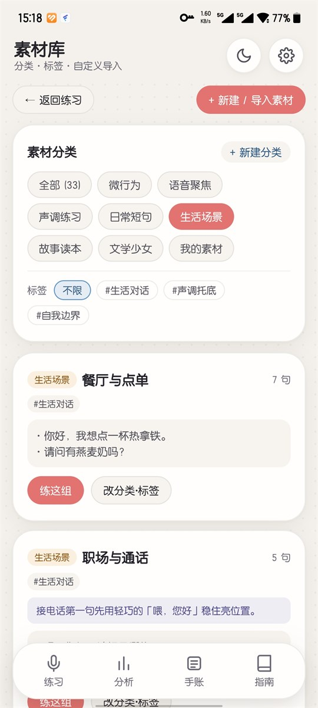

<p align="center">
  
</p>

<p align="center">
  <a href="LICENSE"></a>
  <a href="https://github.com/xling001/radio-diary/releases/tag/v2.1.6"></a>
  <a href="https://xling001.github.io/radio-diary/"></a>
  
  
  
  <a href="CONTRIBUTING.md"></a>
</p>

# 电波日记 MtF 版 (Radio Diary · MtF Edition)

> **面向跨性别女性（MtF）的纯本地嗓音练习手账 · v2.1.6**  
> 零联网上传 · 去病理化表达 · 离线声学反馈 + 练习手账 + 外部 AI 导出联动  
>
> 🌐 **在线网页版（iOS Safari / 桌面端免安装即用）**：👉 **[https://xling001.github.io/radio-diary/](https://xling001.github.io/radio-diary/)**（同样纯本地浏览器计算，iOS Safari 可「添加到主屏幕」作为桌面 App 使用）

---

## 🌸 定位与适用人群说明

**电波日记 MtF 版**（前身为「清籁手帐 1.x」）是一款完全在设备本地离线运行的嗓音练习记录与声学辅助工具，核心设计目标如下：

- **主要面向跨性别女性（MtF / Transfeminine）使用**：软件内的声学参考带（例如安全托底线 150–165 Hz、女声参考区 > 175 Hz、前高元音共鸣 $\Delta F$ 等）、去病理化状态提示文案、内置普通话分场景素材库以及指南内容，均以服务跨性别女性的嗓音练习为目标。
- **对跨性别男性、非二元群体与人声探索者的参考说明**：如果你有声音男性化需求（例如 **跨性别男性 / FtM** 朋友关注音域下探、声道拉长与共鸣下沉），或是有中性声线与多元表达需求的 **非二元（Non-binary）群体** 与声学探索者，都非常欢迎自由参考与复用本项目的开源声学 DSP 算法实现（YIN 基频追踪、LPC 共振峰与 $\Delta F$、$H_1-H_2$ 音重、Jitter / Shimmer / HNR / CPP、咝音重心等）；但本软件本身的界面目标线、常模档位、练习素材与文案内容仍以服务跨性别女性群体为主要目标。

> 📚 **关于理论知识库（已独立开源）**  
> 与本应用配套的普通话跨性别女性嗓音训练体系、解剖生理学与声学常模已作为一个独立开源项目维护和发布：  
> 👉 **[xling001/transvoice-mandarin-handbook（跨性别女性嗓音训练解剖与声学常模知识库 · 普通话版）](https://github.com/xling001/transvoice-mandarin-handbook)**  
> （在线网页阅读：**[xling001.github.io/transvoice-mandarin-handbook](https://xling001.github.io/transvoice-mandarin-handbook/#/preamble)** ；应用内「指南」首章也提供了直达入口卡片。）

---

## 📱 实机界面预览 (v2.1.4)

<table>
  <tr>
    <td align="center" width="33%">
      <br />
      <sub><b>练习 · 分场景跟读与实时音高</b><br />眉批提示 · 160 Hz 托底参照线</sub>
    </td>
    <td align="center" width="33%">
      <br />
      <sub><b>分析 · 音高与声带振动指标</b><br />音区分布 · H1-H2 / HNR / 抖动</sub>
    </td>
    <td align="center" width="33%">
      <br />
      <sub><b>分析 · 谐波衰减与音色象限</b><br />F1–F3 / ΔF 共振与咝音重心</sub>
    </td>
  </tr>
  <tr>
    <td align="center" width="33%">
      <br />
      <sub><b>体感印章 · 主观状态备忘</b><br />舒适感优先 · 与数据对照复盘</sub>
    </td>
    <td align="center" width="33%">
      <br />
      <sub><b>手账 · 12 周脚印与按天归档</b><br />每周自评入口 · 批量对比导出</sub>
    </td>
    <td align="center" width="33%">
      <br />
      <sub><b>素材库 · 8 大内置分类与自建</b><br />日常对话 · 故事 · 文学少女</sub>
    </td>
  </tr>
</table>

---

## ✨ 核心特性

### 1. 三种练习模式 + 自由照镜 + 音频导入
- **自由说**：自然聊天或朗读任意文本，实时观察音高曲线、专属安全托底线（可在 150–165 Hz 间调节）与发声轻重/明暗提示。
- **读素材**：搭配内置分场景练习句库与自定义素材，支持逐句跟练与无注释瀑布流连读双模式（含两档柔和自动滚动）。
- **做测试**：针对持续元音（如 `/i/`、`/u/`）与清擦音 `/s/` 的基准测量，观察前腔共鸣间距 $\Delta F$ 与发音状态。
- **自由照镜模式**：关闭「记入手帐」开关即可随时只看曲线与即时反馈，不占手账空间。
- **本地音频导入**：支持导入手机或电脑中的常见录音文件，复用同一套离线声学分析流水线生成报告。

### 2. 纯本地离线声学引擎 (`ALGO_VERSION 0.5.0` / `KB_VERSION 1.3.0`)
通过 `app/web/src/core/index.js` 只读门面统一暴露，在 Web Worker (`analysis-worker.js`) 中异步执行：
- **音高与安全托底**：YIN 基频追踪、异常跳变剔除、语调跨度（$P_{10}$–$P_{90}$ 半音跨度 `ST`）与跌破安全托底线比例。
- **音重与声门闭合 (Vocal Weight)**：$H_1-H_2$ 修正开商差值、斜率指标与基频减半（Halving）检出，辅助区分过紧压喉与柔和轻盈振动。
- **前腔共鸣与明亮度 (Resonance)**：LPC 线性预测共振峰与 $\Delta F$ 计算、清擦音 `/s/` 频谱重心分析，并包含对挤压代偿的防御联动提示。
- **气流与稳定度**：Jitter、Shimmer、HNR 谐噪比与 CPP 倒谱峰突出度。

### 3. 零联网隐私保护与外部 AI 导出衔接
- **音频不出设备**：所有信号处理、IndexedDB / LocalStorage 持久化均在本地完成，**零云端 API、零埋点**。
- **水彩手账与外部 AI 联动**：每次练习可盖下心情与体感印鉴、回看长线趋势，并一键导出结构化 Markdown / JSON 报告交由你信任的外部 AI 进行复盘。

---

## 📦 下载与使用

- **Android 用户（推荐国内分流）**：可直接在 **[蓝奏云高速分流网盘](https://wwbhg.lanzouv.com/b0o0ji4bc)**（提取密码：`1cvt`）免登录极速下载安装包；亦可在 **[GitHub Releases (v2.1.6)](https://github.com/xling001/radio-diary/releases)** 页面下载（包名保留 `com.transvoice.voice`，支持从旧版「清籁手帐」平滑覆盖升级并保留本地数据）。
- **iOS / 桌面端与试用体验**：无需安装，直接用 Safari / Chrome / Edge 打开在线网页版 👉 **[https://xling001.github.io/radio-diary/](https://xling001.github.io/radio-diary/)**，所有录音和计算同样只在本地浏览器运行；iOS 用户点浏览器底部分享键「添加到主屏幕」即可接近原生离线应用体验（也可一并了解优秀的姊妹开源在线工具 [Koenami](https://github.com/transnavi/koenami)）。
- **自编译开发者**：参见下方目录与本地构建步骤。

---

## 📁 目录结构

```text
radio-diary/
├── assets/                      # 仓库展示图 (Social Preview Banner) 与实机界面截图
├── app/
│   ├── android/                 # 免 Gradle 原生 Android WebView 宿主外壳（包名 com.transvoice.voice）
│   │   ├── AndroidManifest.xml
│   │   ├── java/com/transvoice/voice/MainActivity.java
│   │   └── res/                 # 应用图标与字符串资源
│   ├── web/                     # Svelte 5 + Vite 前端与离线声学引擎
│   │   ├── index.html
│   │   ├── package.json
│   │   ├── vite.config.js
│   │   ├── serve.mjs            # 零依赖本地预览静态服务器
│   │   └── src/
│   │       ├── audio/           # 音频帧抽取与门控前处理 (capture.js)
│   │       ├── core/            # 算法只读门面、分类与报告导出 (index.js, catalog.js, export.js)
│   │       ├── dsp/             # 纯算法模块 (pitch, formants, spectralVoice, sibilance, tone, voiceQuality, cpp, fft)
│   │       ├── metrics/         # 声学常模 (kbNorms.js)、门控汇总与分段统计
│   │       ├── pages/           # 练习、分析、手账、素材库、指南、设置页面
│   │       ├── state/ & store/  # Svelte 5 状态与本地持久化存储
│   │       ├── style/           # 设计 Token 与水彩手账主题样式
│   │       └── ui/              # 基础 UI 组件与弹窗
│   └── scripts/                 # 自动化校验、合成音单测与 Android APK 构建脚本
├── CHANGELOG.md
├── LICENSE
└── LICENSE-THIRD-PARTY.md
```

---

## 🚀 本地开发、校验与打包

### 环境要求
- **Node.js**（建议 v20+，含 `npm`）
- **仅 Android 打包需要**：JDK 17+ / 21、Android SDK `platforms;android-34` 与 `build-tools;34.0.0`（可通过 `app/scripts/setup-android.ps1` 自动配置）

### 1. 安装前端依赖与本地调试
```bash
cd app/web
npm ci
npm run dev       # 启动 Vite 本地开发服务器
npm run build     # 生成纯静态产物至 app/web/dist/
```

### 2. 运行全套静态检查与声学单测（无需真实录音或设备）
```powershell
# PowerShell 静态语法、DOM 引用与转义检查
.\app\scripts\check.ps1

# 架构红线、去病理化措辞、Token 门禁与门面一致性校验
node .\app\scripts\verify-contract.mjs

# Svelte 组件 Design Token 审计
node .\app\scripts\audit-svelte-tokens.mjs

# 声学算法合成信号回归测试
node .\app\scripts\test-pitch.mjs
node .\app\scripts\test-formants-vowel.mjs
node .\app\scripts\test-sibilance.mjs
node .\app\scripts\test-vq.mjs
node .\app\scripts\test-metrics.mjs
node .\app\scripts\test-dsp-full.mjs
node .\app\scripts\test-audit-round.mjs
```

### 3. 构建 Android APK（免 Gradle 极速出包）
```powershell
# 自动触发 Vite build，并通过 aapt2 + javac + d8 + zipalign + apksigner 打包
.\app\scripts\build-apk.ps1
# 输出位于：app\build\radio-diary-v2.1.6.apk
```

---

## 📖 致谢与参考

感谢在跨性别嗓音训练科普、开源工具与语音声学规范上铺路的先驱与研究者：
- **Aoi 的跨性别嗓音训练指南** — 通俗易懂的训练框架与包容视角
- **TransVoice-Wiki 中文翻译项目** & **SumianVoice / Voice Resource Project** — 现代双支柱声学感知框架
- **[Koenami](https://github.com/transnavi/koenami)** — 指标定义、基频减半检出与归一化参考
- **[simple-voice-tools-for-trans](https://github.com/theforeveriris/simple-voice-tools-for-trans)** — 纯前端 YIN 与共振峰实现参考
- **Praat** (Paul Boersma & David Weenink) — 语音声学对照基准
- **《嗓音解剖》(Anatomy of the Voice)** (Theodore Dimon) — 喉部软骨与肌群解剖学参考

### 研发与致谢
- **设计与研发**：**溪泠 ([@xling001](https://github.com/xling001))**，协同 Google Antigravity 完成全栈架构、DSP 算法工程化与手账交互打磨。
- **声学顾问与评审**：感谢 **DSH 老师** 在算法演进过程中提供的严谨声学审计与临床常模建议。

---

## 🤝 参与贡献与社区规范

- **贡献指南**：提交 Issue 或 Pull Request 前请先阅读 [CONTRIBUTING.md](CONTRIBUTING.md)。
- **行为准则**：请共同维护友善、去病理化、尊重多元性别的社区环境，详见 [CODE_OF_CONDUCT.md](CODE_OF_CONDUCT.md)。
- **安全与隐私**：如发现本地存储、导出或 WebView 权限边界相关问题，请参考 [SECURITY.md](SECURITY.md)。

---

## 📄 开源许可证

本项目基于 [MIT License](LICENSE) 开源；构建期依赖与算法参考声明详见 [LICENSE-THIRD-PARTY.md](LICENSE-THIRD-PARTY.md)。
